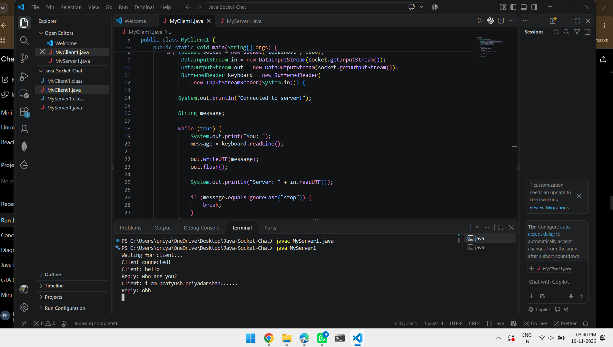
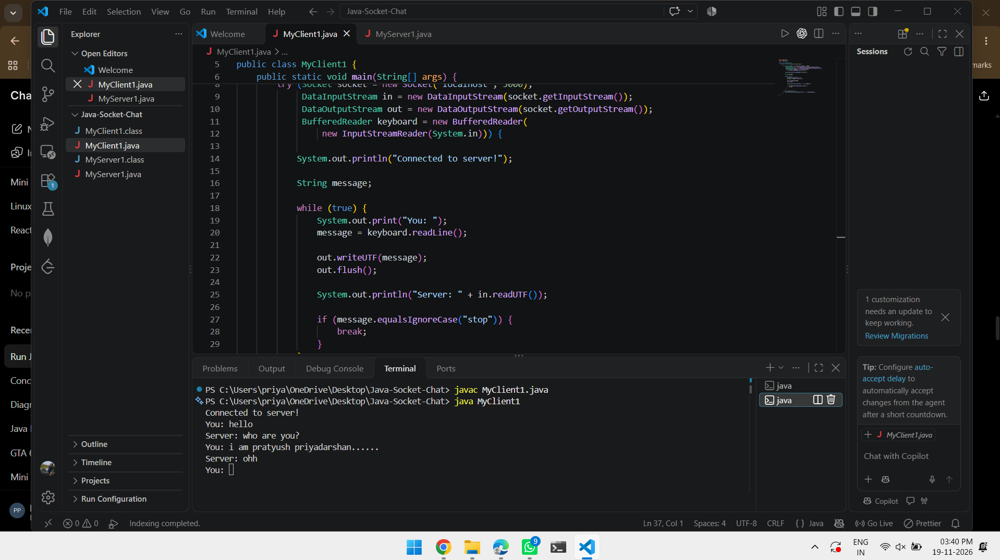

# Java Socket Programming - Client Server Chat

This is a simple Java mini project based on Socket Programming. It demonstrates how a client and server communicate with each other using TCP connections.

The client sends messages to the server, and the server receives them and sends replies.

### Technologies Used
- Java
- Socket Programming
- TCP/IP

### Project Files
- MyServer1.java – Handles client connections and sends replies.
- MyClient1.java – Connects to the server and sends messages.


### Screenshots

Server Terminal



Client Terminal




### Core Concepts
- ServerSocket – Creates a server and listens for connections.
- Socket – Establishes a connection between client and server.
- DataInputStream – Receives messages.
- DataOutputStream – Sends messages.
- BufferedReader – Takes user input.

### How to Run

Start the server:

```bash
javac MyServer1.java
java MyServer1
```

Open another terminal and start the client:

```bash
javac MyClient1.java
java MyClient1
```

Type `stop` to end the chat.

### What I Learned
- Basics of Java networking.
- Client-server communication.
- TCP connections.
- Working with sockets and input/output streams.
